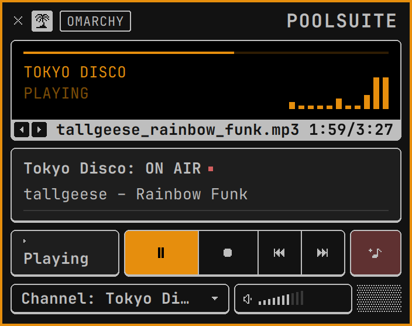
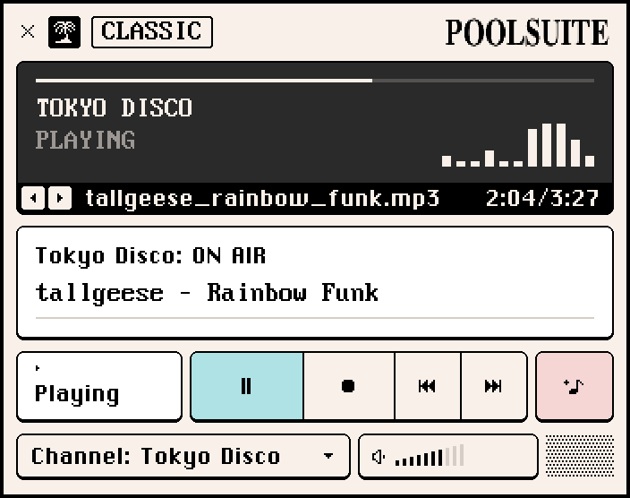

# Poolsuite for Omarchy

A tiny [Poolsuite FM](https://poolsuite.net/) player that lives in the [Omarchy](https://omarchy.org/) bar. Click the pixel palm tree and a little 90s-style console drops down: now playing, transport keys, eight channels and a volume control. There's no browser and no window. The audio is a headless `mpv` playing Poolsuite's public SoundCloud playlists.

| Follows your Omarchy theme | Classic Poolsuite look |
| --- | --- |
|  |  |

> **Unofficial.** This is a fan-made client and isn't affiliated with or endorsed by Poolsuite. All the curation is theirs, so please support them: [poolsuite.net](https://poolsuite.net/), their apps, and [SoundCloud](https://soundcloud.com/poolsuite).

## Features

- **Lives in the bar.** A 1-bit palm tree that lights up in your accent colour while music plays.
- **Two looks.** One follows your current Omarchy theme and font and changes when you switch themes. The other is the classic System 7 look: cream, aqua and pink, Chicago and DOS VGA pixel type, raised keys and dithering. Switch with the button in the player's title bar.
- **Eight channels**, each shuffled: Poolsuite FM, Poolsuite FM Two, Balearic Sundown, Indie Summer, Tokyo Disco, Friday Nite Heat, Hangover Club and Mixtapes. There's also a 🎲 key that jumps to a random channel.
- **Proper track names everywhere.** These show in the player, the bar tooltip and Omarchy's media notifications, and they're right from the moment you skip.
- **Normal media controls.** It's an MPRIS player, so media keys and `playerctl` work as usual.
- **Light.** It only runs `mpv` while the radio is on. Stop (■) turns it off completely.

## Install

You need [Omarchy](https://omarchy.org/) with its standard bar. Clone it, read the installer if you like (it's short), and run it:

```bash
git clone https://github.com/lucasclgibson/omarchy-poolsuite.git ~/.local/share/omarchy-poolsuite
cd ~/.local/share/omarchy-poolsuite
less install.sh
./install.sh
```

Or do the same in one line:

```bash
curl -fsSL https://raw.githubusercontent.com/lucasclgibson/omarchy-poolsuite/main/install.sh | bash
```

Then click the palm tree in your bar, or pick **Poolsuite** from the Super+Space menu.

An AUR package (`yay -S omarchy-poolsuite`) is on the way; its recipe is in [`packaging/aur/`](packaging/aur/).

### What the installer changes

- **Packages:** installs any of `mpv`, `mpv-mpris`, `yt-dlp`, `jq`, `socat`, `unzip` and `curl` that are missing, using `omarchy pkg add`. This is the only step that needs your password, and only when something is missing.
- **The `poolsuite` command:** links `~/.local/bin/poolsuite` to the code.
- **Fonts:** downloads the two free fonts for the classic look into `~/.local/share/fonts/poolsuite/` and checks each against a recorded checksum.
- **`poolsuite setup`:**
  - links the bar plugin into `~/.config/omarchy/plugins/poolsuite`;
  - adds the widget's entry to the bar layout in `~/.config/omarchy/shell.json`;
  - adds one line to `~/.config/omarchy/extensions/omarchy-menu.jsonc` for the Super+Space menu.

Nothing else is touched, and nothing runs as root except the package install. Running it again is safe and doesn't duplicate anything.

```bash
poolsuite update      # get the latest version (git pull, then re-run the installer)
poolsuite uninstall   # undo all of the above (add --fonts to remove the fonts too)
```

If you're hacking on it, run `./install.sh` from any clone and everything is linked to that clone, so your edits apply straight away. Run `omarchy restart shell` after changing QML. A keybinding (Super+Alt+P) is in [`extras/hyprland-binding.lua`](extras/hyprland-binding.lua) if you want one.

## Use

In the bar:

| Action | What it does |
| --- | --- |
| Click | Open or close the player |
| Middle-click | Play / pause |
| Right-click | Next track |
| Scroll | Volume |

In the player, the four transport keys are play/pause, stop (turns the radio off), previous and next. The 🎲 key picks a random channel. The **Channel** box opens a pop-up menu, and the bars next to the speaker set the volume.

From a terminal:

```text
poolsuite                  open the bar player
poolsuite play [channel]   start the radio (last channel by default)
poolsuite toggle           play/pause, starting the radio if it's off
poolsuite next | previous | pause
poolsuite quit             turn the radio off
poolsuite channels         list channels
poolsuite theme [omarchy|poolsuite]
poolsuite refresh [ch…]    rebuild the cached track lists
poolsuite setup            put it on your bar and in the Super+Space menu
poolsuite unsetup          take it off again
poolsuite update           get the latest version
poolsuite uninstall        remove it
```

The look is also a widget setting (`theme`: `Omarchy` or `Poolsuite`) on the widget's entry in `~/.config/omarchy/shell.json`.

## How it works

- **`bin/poolsuite`** runs `mpv --shuffle` on a channel. Before mpv can play a SoundCloud track it has to resolve it, and until then all it has for a title is a track number. So the script asks `yt-dlp` once for each channel's full track list and caches it as an `.m3u` with each track's `Artist - Title`, in `~/.cache/poolsuite/`. That takes about 20 seconds per channel and runs in the background the first time a channel plays, then weekly. With the cached list, the title is right from the first moment. If a list arrives while that channel is already playing, it's swapped in after the current song.
- **`mpv-mpris`** exposes the player on D-Bus. The bar widget finds that exact `mpv` (by PID) through Quickshell's MPRIS service and drives it directly.
- **`plugin/`** is the Omarchy shell plugin (Quickshell/QML). `Player.qml` is the popup. `PixelIcon`, `Bevel` and `PText` are the 1-bit sprites, raised keys and pixel type, and they take their colours from the active palette.
- **`share/guard.lua`** is an mpv script. If five tracks in a row fail to load, it stops the radio and the player shows "Offline" instead of racing through the playlist.
- **`install.sh`** handles packages, fonts and the command. **`poolsuite setup`** handles the per-user wiring (plugin link, bar entry, menu line), so a system package can reuse it. The script finds its files next to itself in a clone, or in `/usr/share/omarchy-poolsuite` when installed as a package.

## Troubleshooting

- **"Offline: SoundCloud unavailable".** `yt-dlp` couldn't get tracks from SoundCloud. SoundCloud sometimes rate-limits it (try again later), and SoundCloud changes regularly break older `yt-dlp` versions, so update it. You can test with `yt-dlp -J https://soundcloud.com/poolsuite/sets/tokyo-disco`.
- **Changes to the QML don't show up.** Run `omarchy restart shell`.
- **The classic look uses the wrong font.** Run `poolsuite update`, or `./install.sh` from your clone, and check that `fc-list | grep -i "chicago kare"` finds it.
- **The palm tree isn't on the bar.** Run `poolsuite setup`.

## Uninstall

```bash
poolsuite uninstall           # keeps the fonts
poolsuite uninstall --fonts   # removes them too
```

This takes the widget off the bar and the entry out of the menu, and deletes the command, the plugin link, the cached track lists and the code in `~/.local/share/omarchy-poolsuite`. Any packages it installed are left in place. A `shell.json` backup is kept next to the original.

## Credits and licences

- Code: [MIT](LICENSE).
- The channel list comes from [jamespember/poolsuite-cli](https://github.com/jamespember/poolsuite-cli) (MIT).
- [Chicago Kare](https://github.com/KingDuane/Chicago-Kare) by Duane King (MIT), downloaded at install time.
- IBM VGA 8x16 from [The Ultimate Oldschool PC Font Pack](https://int10h.org/oldschool-pc-fonts/) by VileR ([CC BY-SA 4.0](https://creativecommons.org/licenses/by-sa/4.0/)), downloaded at install time.
- The music and its curation belong to Poolsuite and the artists. This player only plays their public SoundCloud playlists.
